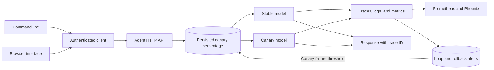

# Observable Production Agent

Serve an authenticated agent API with health checks, durable request metrics, optional OTLP tracing, canary traffic, and automatic rollback.

The service exposes authenticated `/metrics`, `/prometheus`, and `/alerts` endpoints. Supply a stable `run_id` on related `/run` calls to detect repeated prompts and stop loops. Canary rollback and loop events are persisted in the alert table.

`deploy/prometheus.yml` and `deploy/alert-rules.yml` provide a scrape configuration and alerts for failure rate, loops, and rollback. Place the API token in the referenced secret file and route Prometheus alerts to your alert manager.

For a single-node deployment, copy `.env.example` to `.env`, replace the example secrets and model names, then run `docker compose up --build -d`. The compose file binds port 8080 to localhost and persists rollout and metric state in `agent_data`. Put TLS and access controls in a reverse proxy before exposing it.

See [OPERATIONS.md](OPERATIONS.md) for deployment checks, canary rollout, alert routing, backup, and recovery.

## Quick start

The installed `production-agent` command starts and operates the HTTP service. Set `OPENAI_API_KEY` and `AGENT_API_TOKEN`, then run `production-agent serve`. In a second terminal run `production-agent run "Summarize the incident"`, `production-agent metrics`, `production-agent alerts`, or `production-agent rollout 5`. The same service serves an operator browser at `http://127.0.0.1:8080/`; enter the API token to run prompts, inspect metrics and alerts, and change canary allocation.

Requires Python 3.11 or newer. From this repository:

```powershell
python -m venv .venv
.\.venv\Scripts\Activate.ps1
python -m pip install -e '.[tracing,dev]'
pytest -q
```

On macOS or Linux:

```bash
python3 -m venv .venv
source .venv/bin/activate
python -m pip install -e '.[tracing,dev]'
pytest -q
```

For live model calls, set `OPENAI_API_KEY` and optionally `OPENAI_MODEL` and `OPENAI_BASE_URL` as shown in `.env.example`. The test suite uses stubs and needs no model key.

```powershell
# PowerShell:
$env:OPENAI_API_KEY = "your-key"
$env:AGENT_API_TOKEN = "replace-with-a-long-random-token"
$env:CANARY_PERCENT = "5"
# Optional Arize Phoenix endpoint, with the tracing extra installed:
$env:OTEL_EXPORTER_OTLP_TRACES_ENDPOINT = "https://app.phoenix.arize.com/v1/traces"
python -m observable_production_agent
# GET /healthz; authenticated GET /metrics; POST /run {"prompt":"..."}; POST /rollout {"percent":5}
```

## Architecture



| Component | Responsibility |
|---|---|
| API | Authenticates calls and exposes health, rollout, metrics, and alerts. |
| Rollout store | Persists variant allocation and disables a failing canary. |
| Observability | Exports OTLP spans and Prometheus metrics with alert rules. |

Authenticated HTTP request -> persisted rollout allocation -> stable/canary model -> OpenTelemetry span and JSON log -> SQLite latency/cost/error metric -> rollback when canary failure rate crosses threshold.

See [ARCHITECTURE.md](ARCHITECTURE.md) for components, state, failure behavior, and operations.

## Deployment and safety

Run behind TLS and a reverse proxy. Mount /data on persistent storage. The cost metric is an estimate; production billing reconciliation needs provider usage fields. Set `PHOENIX_API_KEY` when the Phoenix collector requires authentication; the exporter sends it as a bearer token. Rollback triggers from the observed window and is persisted.

A Dockerfile is included for the HTTP service. Set secrets through your deployment platform and persist the SQLite database on a mounted volume.

## Verification

`pytest -q` runs deterministic tests. GitHub Actions runs the same suite on pushes and pull requests.

## License

MIT. See [LICENSE](LICENSE).
