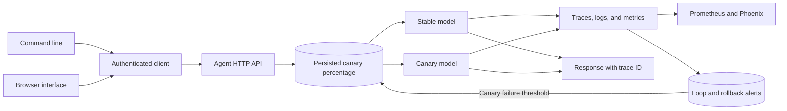

# Observable Production Agent

## About

This service is for teams operating an AI endpoint and needing to understand how it behaves after deployment. It runs prompts through a stable model or a canary model, records latency, estimated cost, errors, and repeated-call loops, and can turn off the canary when its observed failure rate crosses a threshold. Operators can inspect the service through its API, CLI, or browser.

### What you can do

- Serve an authenticated agent endpoint with health and metrics routes.
- Route a chosen percentage of traffic to a canary model and roll it back on failures.
- Watch errors, latency, loop alerts, and estimated model cost.
- Export Prometheus metrics and optional OpenTelemetry traces.

This is a self-hosted service with Docker Compose and an operations guide; it is not yet deployed at a public URL. The included monitoring files are starting points for a single-node installation. Cost figures are estimates and should be reconciled with provider billing.

## Quick start

The installed `production-agent` command starts and operates the HTTP service. Set `OPENAI_API_KEY` and `AGENT_API_TOKEN`, then run `production-agent serve`. In a second terminal run `production-agent run "Summarize the incident"`, `production-agent metrics`, `production-agent alerts`, or `production-agent rollout 5`. The same service serves an operator browser at `http://127.0.0.1:8080/`; enter the API token to run prompts, inspect metrics and alerts, and change canary allocation.

Requires Python 3.11 or newer. From this repository:

```powershell
python -m venv .venv
.\.venv\Scripts\Activate.ps1
python -m pip install -e '.[tracing,dev]'
pytest -q
```

On macOS or Linux:

```bash
python3 -m venv .venv
source .venv/bin/activate
python -m pip install -e '.[tracing,dev]'
pytest -q
```

For live model calls, set `OPENAI_API_KEY` and optionally `OPENAI_MODEL` and `OPENAI_BASE_URL` as shown in `.env.example`. The test suite uses stubs and needs no model key.

```powershell
# PowerShell:
$env:OPENAI_API_KEY = "your-key"
$env:AGENT_API_TOKEN = "replace-with-a-long-random-token"
$env:CANARY_PERCENT = "5"
# Optional Arize Phoenix endpoint, with the tracing extra installed:
$env:OTEL_EXPORTER_OTLP_TRACES_ENDPOINT = "https://app.phoenix.arize.com/v1/traces"
python -m observable_production_agent
# GET /healthz; authenticated GET /metrics; POST /run {"prompt":"..."}; POST /rollout {"percent":5}
```

## Architecture



| Component | Responsibility |
|---|---|
| API | Authenticates calls and exposes health, rollout, metrics, and alerts. |
| Rollout store | Persists variant allocation and disables a failing canary. |
| Observability | Exports OTLP spans and Prometheus metrics with alert rules. |

Authenticated HTTP request -> persisted rollout allocation -> stable/canary model -> OpenTelemetry span and JSON log -> SQLite latency/cost/error metric -> rollback when canary failure rate crosses threshold.

See [ARCHITECTURE.md](ARCHITECTURE.md) for components, state, failure behavior, and operations.

## Deployment and safety

Run behind TLS and a reverse proxy. Mount /data on persistent storage. The cost metric is an estimate; production billing reconciliation needs provider usage fields. Set `PHOENIX_API_KEY` when the Phoenix collector requires authentication; the exporter sends it as a bearer token. Rollback triggers from the observed window and is persisted.

A Dockerfile is included for the HTTP service. Set secrets through your deployment platform and persist the SQLite database on a mounted volume.

## Verification

`pytest -q` runs deterministic tests. GitHub Actions runs the same suite on pushes and pull requests.

## Product guide

### Run and observe a request

Send an authenticated prompt to `/run` or use `production-agent run`. The service chooses the stable or canary model according to the persisted rollout percentage, records the request outcome, and returns a trace ID with the response. Supply the same `run_id` for related calls so repeated prompts can be recognized as a possible loop.

| Endpoint or command | Operator use |
|---|---|
| `/healthz` | Check whether the process is responding. |
| `/run` | Execute an agent request with a prompt and optional run ID. |
| `/metrics` and `/prometheus` | Inspect JSON metrics or scrape Prometheus-format metrics. |
| `/alerts` | Read loop and rollback events. |
| `/rollout` or `production-agent rollout` | Change the percentage of canary traffic. |

The operator browser presents run, metrics, alerts, and rollout controls. It is designed to be placed behind access controls, with its API token entered by the operator rather than embedded in the page.

### Canary behavior

Start with a small canary percentage, send representative requests, and watch latency and error rate. The rollout store survives a service restart. When the observed canary failure window crosses the configured threshold, the service records an alert and sets canary traffic back to zero. This is an application-level rollback of routing; it does not remove a deployment or undo external side effects.

### Configuration and operations

| Setting | Purpose |
|---|---|
| `AGENT_API_TOKEN` | Authenticate operator and run endpoints. |
| `OPENAI_API_KEY`, `OPENAI_BASE_URL`, model names | Connect stable and canary model providers. |
| `CANARY_PERCENT` | Initial canary allocation. |
| `OTEL_EXPORTER_OTLP_TRACES_ENDPOINT`, `PHOENIX_API_KEY` | Optional trace export. |

The supplied Compose file persists rollout and metrics state in `agent_data` and binds the service to localhost. Put TLS and a reverse proxy in front of it before external traffic. `deploy/prometheus.yml` and `deploy/alert-rules.yml` are starting points for monitoring; configure alert delivery for your environment. Cost is estimated and should be reconciled with provider usage. See [OPERATIONS.md](OPERATIONS.md) for release, backup, and recovery steps and [ARCHITECTURE.md](ARCHITECTURE.md) for the request path.

### Common issues

| Symptom | Check |
|---|---|
| `/run` is unauthorized | Supply the configured API token through the expected header or CLI environment. |
| Traces are absent | Verify the OTLP endpoint, optional Phoenix key, and that the tracing extra is installed. |
| Canary traffic returns to zero | Inspect `/alerts` and recent failure metrics; rollback may have fired. |
| Cost and billing disagree | The built-in cost figure is an estimate; use provider usage records for reconciliation. |

Test rollback with a deliberately failing canary before relying on it. Retain enough metrics to explain a rollback, and define who responds to each alert in the operational runbook.

## License

MIT. See [LICENSE](LICENSE).
